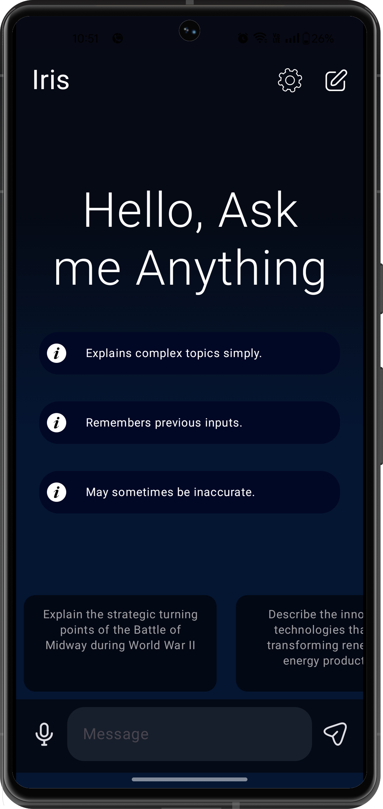
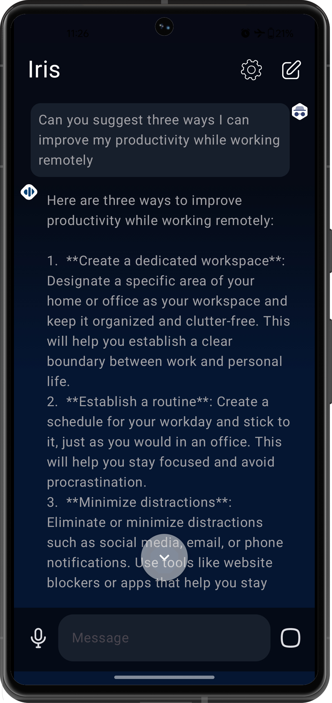
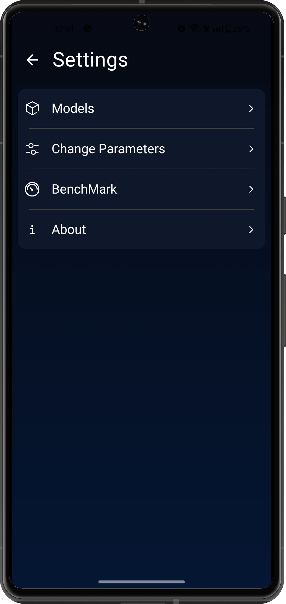
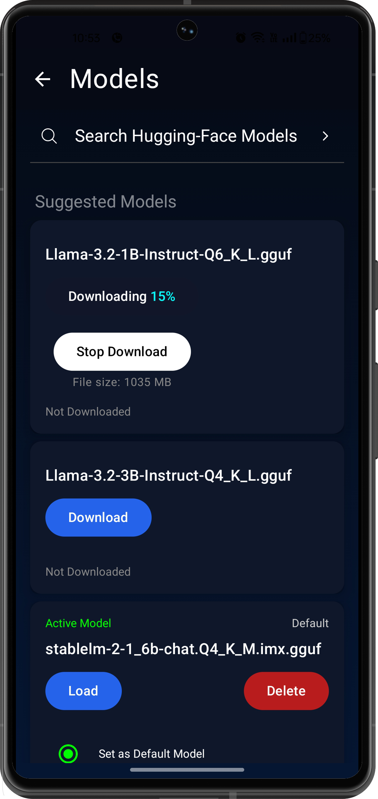
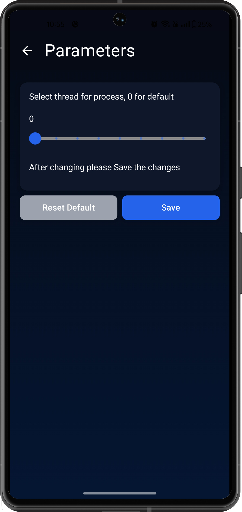

<h2>IRISStar</h2>

## Project Description

- This repository contains llama.cpp based offline android chat application cloned from llama.cpp android example. Install, download model and run completely offline privately.
- The app supports downloading GGUF models from Hugging Face and offers customizable parameters for flexible use.
- Being open-source, it allows for easy modifications and improvements, providing a secure, private, and fully offline experience.

## Images

<div style="display: flex; gap: 15px; justify-content: center; flex-wrap: wrap;">
  <div style="text-align: center; width: 200px;">
    
    <p><strong>Main Screen</strong></p>
    <p>This is the main interface of the app where users can access all core functionalities.</p>
  </div>
  <div style="text-align: center; width: 200px;">
    
    <p><strong>Chat Screen</strong></p>
    <p>The chat feature allows users to interact in real-time and access AI-driven responses.</p>
  </div>
  <div style="text-align: center; width: 200px;">
    
    <p><strong>Settings Screen</strong></p>
    <p>Users can customize app preferences and configure their account settings here.</p>
  </div>
  <div style="text-align: center; width: 200px;">
    
    <p><strong>Models Screen</strong></p>
    <p>This screen displays available AI models and allows users to manage them efficiently.</p>
  </div>
  <div style="text-align: center; width: 200px;">
    
    <p><strong>Parameters Screen</strong></p>
    <p>Users can adjust parameters to fine-tune the app's performance based on their needs.</p>
  </div>
</div>

## Run

- Go to releases : https://github.com/lukifer23/IRISStar/releases
- Download app
- Install app

## Features

- Works Offline: Access all features without needing an internet connection.
- Privacy-Focused: All data is processed securely on your device.
- Expandable Models: Download external GGUF models from Hugging Face.
- Open Source: Fully transparent development.
- Customizable Parameters: n_threads, top_k, top_p, and temperature can be adjusted to optimize performance and behavior based on device capabilities and desired output.
- Text To Speech: Support for Text-to-Speech functionality.
- Speech To Text: Support for Speech-to-Text functionality.
- Default Model Selection: Set a default model to load automatically on startup.

## GPU Backends (Vulkan/OpenCL) on Android

IrisStar integrates llama.cpp GPU backends via dynamic loading:

- Vulkan: Preferred on modern Android (Adreno). Loaded at runtime from system `libvulkan.so` and packaged `libggml-vulkan.so` plugin.
- OpenCL: Loaded if vendor `libOpenCL.so` is available; the ggml OpenCL plugin is loaded dynamically when present.

How to enable and verify:

1. Settings → Detect Hardware to populate available backends (e.g., `CPU,Vulkan`).
2. Select Backend (Vulkan/OpenCL/CPU). The app will unload and reload the model so the change takes effect.
3. Run CPU vs GPU Test on the Benchmark screen to compare throughput.

Notes and recommendations for mobile GPUs:

- Chat defaults (mobile): `n_ctx=2048`, `n_batch=256`, `n_ubatch=64`. These values reduce KV memory and improve stability on mobile GPUs.
- Generation cap: default `n_len=256` tokens per response.
- GPU layers: default Auto (offload as many as fit). User can set exact layer count in Settings.
- If you see `failed to find ggml_backend_init in libggml-vulkan.so` during startup but Vulkan is reported as present, it is benign; the backend registry still succeeds.

Troubleshooting:

- Switching backends but still seeing the previous one: the app now forcefully unloads/reloads the model on backend change; reselect your backend and reload the model.
- GPU latency too high: try a smaller model and/or reduce context length in Settings; Vulkan backends on mobile benefit from smaller ctx and micro-batching.

### Runtime Diagnostics and Stability

- The app exposes a native diagnostics snapshot used by the UI logs after model load. It includes backend registry, active contexts, GPU offload counts, KV size, and micro-batch size.
- Backend switching is now safe: the runtime defers backend teardown when contexts are active to avoid crashes. Change backend in Settings, then reload the model.
- GPU benchmark safety: if the device reports zero GPU offload or a CPU-forced session, the benchmark skips the GPU path and reports a clear reason instead of crashing.
- Token logging is gated to avoid excessive log traffic during generation; verbose token logs can be enabled in development builds.

## Optimizing Your Experience with Iris

The performance of Iris is directly influenced by the size, speed, and compute requirements of the models you use. These factors also impact the overall user experience. For a faster and smoother experience, consider downloading smaller models.

**Example Recommendation:**  
On opening the app, users can download suggested models to optimize performance based on their preferences and device capabilities.

---

#### Note:

- Smaller models are ideal for quicker interactions but may compromise slightly on response quality.
- Larger models offer more comprehensive responses but require higher compute power and may result in slower speeds.
- Choose a model that best balances speed and quality for your specific use case.

---

#### Disclaimer:

- Iris may produce **inaccurate results** depending on the complexity of queries and model limitations.
- Performance and accuracy are influenced by the size and type of model selected.

## Build

- Install Android Studio (or use Cursor + Gradle)
- Clone this repository and import

```bash
 git clone https://github.com/lukifer23/IRISStar.git
```

- Clone the llama.cpp repository alongside IRISStar (same parent folder)

```bash
 git clone https://github.com/ggerganov/llama.cpp
```

## Credentials

- Set your HuggingFace token and username in Settings → HuggingFace Integration.
- Optional: set Google API Key and Custom Search Engine ID in Settings for web search.
- Do not hardcode credentials in source; they are stored securely via encrypted preferences.

### Building with GPU backends

- Vulkan: no extra steps on device; ensure you have `vulkan-headers` on host for cross-compilation (e.g., Homebrew `vulkan-headers`).
- OpenCL: requires a vendor `libOpenCL.so` on the device. The app loads ggml OpenCL backend at runtime when available.
- Open developer options on the Android mobile phone.
- Enable developer options.
- Click on developer options and enable wireless debugging.
- In Android Studio, select the drop down on the left side of the 'app' button on the Navbar.
- Select on 'Pair devices using Wi-Fi'. A QR code appears on screen.
- Click on wireless debugging on Android phone. Select 'Pair device with QR code'. Scan the code. (Make sure both devices are on the same Wi-fi)
- You can use Usb Debugging also to connect your phone.
- Once the phone is connected, select the device name in the drop down menu and click on play button.
- In the app, download at least one model from the given options.
- Now you can run the app offline. (In airplane mode as well)

## Contributing

1. **Fork the repository.**
2. **Create a new feature branch:**
   ```bash
   git checkout -b my-new-feature
   ```
3. **Commit your changes:**
   ```bash
   git commit -m 'Add some feature'
   ```
4. **Push your branch to the remote repository:**
   ```bash
   git push origin my-new-feature
   ```
5. **Open a Pull Request.**
